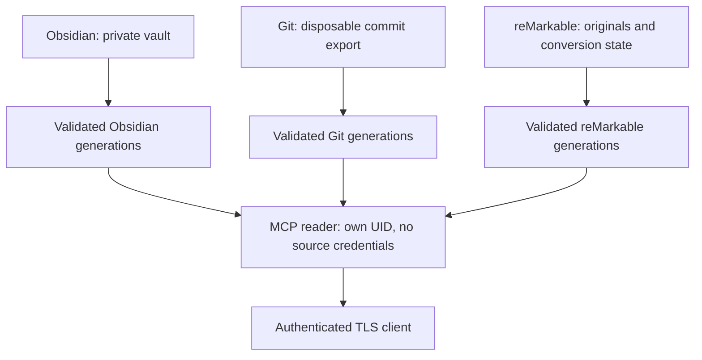

# Obsidian Headless Hardened — development preview

An isolated, pull-only Obsidian Sync client for Home Assistant, with optional Git and reMarkable acquisition and a small authenticated, read-only MCP service.

**Status: `0.1.0-dev`. Local regression tests are not a Home Assistant production qualification. This source profile has no published container release and no completed real HA/cloud acceptance run.** See [validation and remaining gates](docs/validation.md) before installing it on a machine that controls a home.

Based on [conallob/hassio-obsidian-headless](https://github.com/conallob/hassio-obsidian-headless) at `3b856fa68892f3a8e1c4548cdc46b649b87de0e2`. This is a substantial replacement of its runtime and data boundaries, not a configuration-compatible upgrade.

## What this profile does

| Component | Behavior |
|---|---|
| Obsidian | Uses official `obsidian-headless` 0.0.14, verifies the configured vault identity and pull-only mode, completes a one-shot acquisition, then publishes a validated copy. An existing Obsidian Sync subscription and remote vault are required. |
| Git | Fetches a specified HTTPS branch into disposable private storage, exports an immutable commit, and publishes independent namespaces. It never adopts or resets an existing personal worktree. |
| reMarkable | Acquires retained local bundles using a pinned, patched `rmapi`, preserves original bytes privately, and generates Markdown/PDF outputs with content hashes, owned-output checks and journal recovery. Local retention is explicitly distinguished from current cloud membership. |
| MCP | Offers exactly `list_documents`, `read_document` and `search_documents` through the official Python MCP SDK. All HTTP routes require a bearer token; the managed service requires TLS and explicit trusted hosts. |
| Supervision | Four service UIDs, separate private directories and environments, bounded retry/command execution and health that distinguishes failure, disabled services and stale acquisition. |

Git/reMarkable outputs stay in their own source namespaces. They are available through the reader, but are **not written back into the personal Obsidian vault**. This profile is a reading and ingestion service, not a bidirectional editing bridge.

The old token/pairing web interfaces, OAuth configuration, write tools, bundled tunnels, `eval` configuration, shared writable vault mount and automatic upstream release workflows are removed. Obsolete options are rejected. Clients that require OAuth rather than a configured bearer token need a different integration; compatibility with any particular hosted assistant has not been established.

## Data boundaries



| Directory inside the add-on | Owner / access | Purpose |
|---|---|---|
| `/data/obsidian` | UID 10001, private `0700` | CLI credentials/state and live pull-only vault |
| `/data/git` | UID 10002, private `0700` | Disposable acquisition workspaces |
| `/data/remarkable` | UID 10003, private `0700` | Credentials, original bundles, conversion journals and generated candidates |
| `/data/mcp` | UID 10004, private `0700` | Reader state and supplied TLS key |
| `/data/published/<source>` | Source UID; group 10004 can read, not write | Complete immutable generations, manifest and current pointer |

Source workers also belong to the publication reader group. They can read published material, but cannot read another source's private workspace or overwrite another source's publication. Home Assistant/container root remains trusted and can read the managed options and all local plaintext. The add-on receives no Home Assistant API permission, host networking, writable share mount or SSL-directory mount.

The publisher copies only its documented file types, rejects unsafe links and paths, records SHA-256/size/provenance, fsyncs a complete generation and switches the current pointer atomically. It retains three recent generations and any older generation currently leased by a reader. Unchanged verified content and revision reuse the existing generation. Staging and retired derived data can be recovered/cleaned after a crash. **These snapshots are finite working copies, not backups.**

## Start with a disposable local build

This repository retains the upstream source-project layout. It is **not yet an add-on-store distribution repository**. For a development pilot, copy a reviewed checkout into Home Assistant's local add-on directory, usually `/addons/obsidian_headless_hardened/`, then refresh the local add-on list and build it there. Keep the new slug `obsidian_headless_hardened`; do not replace a production instance in place.

The host/container build needs internet access to pinned official package sources. No build downloads credentials or private notes. The Dockerfile targets Linux amd64 and arm64; the manifest calls the latter `aarch64`.

```bash
docker build --build-arg BUILD_VERSION=0.1.0-dev -t obsidian-headless-hardened:dev .
```

Native [GitHub CI](https://github.com/kamikazaaa/hassio-obsidian-headless/actions/workflows/verify.yaml) runs the Python/Go checks, builds both target images and checks the installed runtimes offline under unprivileged identities. It then runs the [Docker/S6 integration harness](docs/container-integration.md) through the image's actual `/init` entrypoint with synthetic sources, separate service UIDs and real publication/TLS/MCP checks. Inspect the completed results and per-architecture artifacts for the exact commit you intend to use. A Docker/S6 pass establishes the tested container lifecycle; Home Assistant Supervisor, actual cloud accounts and independent restore still require their separate [acceptance gates](docs/validation.md).

Minimum managed options:

```yaml
obsidian_auth_token: "REPLACE_WITH_YOUR_PRIVATE_OBSIDIAN_TOKEN"
vault_name: "Your exact remote vault name or ID"
vault_password: "REPLACE_IF_THE_VAULT_USES_E2EE"
obsidian_sync_interval: 300
enable_git_sync: false
enable_remarkable: false
enable_mcp: false
```

Follow [DOCS.md](DOCS.md) for token provisioning, Git sources, pairing, TLS, health, recovery and migration. Port 8420 is unmapped by default. Leave MCP disabled until a validated publication and an authenticated client test exist.

## Development and provenance

- [Implementation contract](docs/hardening-plan.md)
- [Dependency/build provenance](docs/build-provenance.md)
- [Validation evidence and acceptance gates](docs/validation.md)
- [Threat model, security boundaries and residual risks](SECURITY.md)
- [reMarkable integrity details](remarkable-sync/README.md)

Python runtime dependencies are fully pinned with distribution hashes in `requirements.lock`. The Obsidian package and its npm dependencies are locked; image digests, Debian snapshot inputs and the patched downloader source are recorded with the build. Updates need review and renewed tests. Pinning does not establish that dependencies have no vulnerabilities.

This add-on's original code is covered by the **BSD 3-Clause** [LICENSE](LICENSE), whose copyright notice is retained. Dependencies have their own licenses. The official Obsidian package declares `UNLICENSED`; this project does not grant rights to redistribute it. No automatic public image publication is enabled. Review the applicable upstream terms before distributing binaries.
